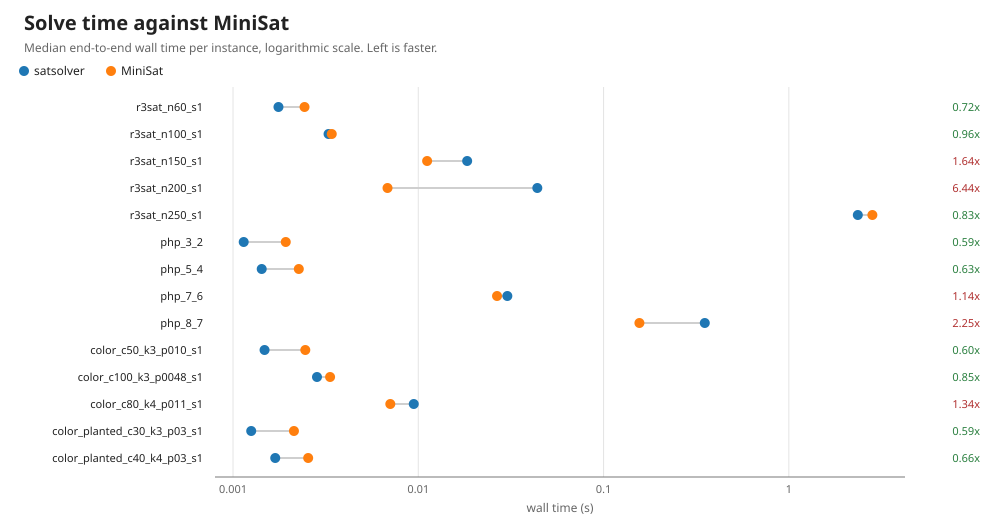
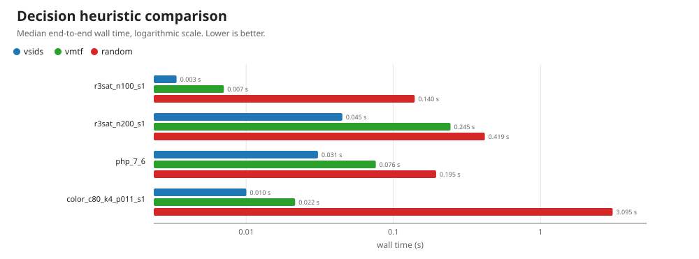
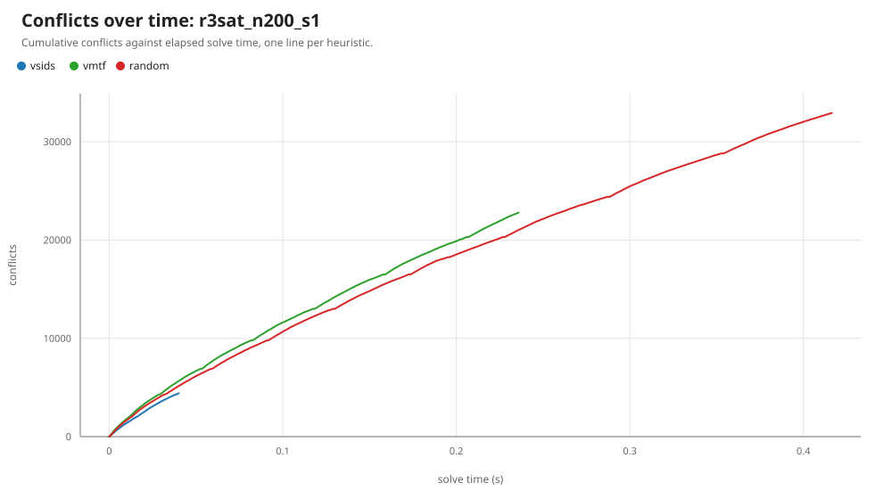
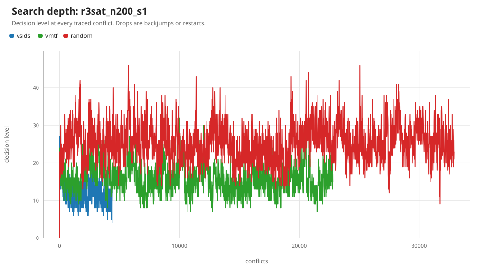

# sat-solver

[](https://github.com/IkerAbad/sat-solver/actions/workflows/ci.yml)

A from-scratch CDCL SAT solver in C++23, plus a DIMACS toolchain, DRAT proof
emission and a reproducible benchmark against MiniSat 2.2.1.

The solver implements watched literals, first-UIP conflict analysis, learned
clause minimization, VSIDS, VMTF and random branching, phase saving, Luby
restarts and LBD-based clause-database reduction. On UNSAT it can emit a DRAT
refutation that CI checks with drat-trim. It has no external dependencies.
Python is used only for checking, benchmarks and figures.

## Results

Measured on 14 deterministic instances, all solved with verified answers. The
table is end-to-end wall time (process start included), median of the
successful repetitions. `satsolver` uses VSIDS. Reference: MiniSat 2.2.1.

Environment: GitHub Actions `ubuntu-latest` (Ubuntu 26.04), GCC 15.2.0,
MiniSat 2.2.1 from the Ubuntu package, CI run 45202422247 on 2026-11-23.
The runner is shared, so absolute times vary between runs; this table and the
figures are from that one run. Times below roughly 10 ms are dominated by
process startup.

| Instance | Status | satsolver s | conflicts | MiniSat s | conflicts | ratio |
|---|---:|---:|---:|---:|---:|---:|
| r3sat_n60_s1 | UNSAT | 0.0021 | 119 | 0.0027 | 99 | 0.78x |
| r3sat_n100_s1 | UNSAT | 0.0039 | 435 | 0.0040 | 463 | 0.98x |
| r3sat_n150_s1 | SAT | 0.0214 | 2,343 | 0.0126 | 2,283 | 1.70x |
| r3sat_n200_s1 | SAT | 0.0515 | 4,418 | 0.0077 | 947 | 6.67x |
| r3sat_n250_s1 | UNSAT | 2.917 | 126,465 | 3.258 | 452,349 | 0.90x |
| php_3_2 | UNSAT | 0.0014 | 7 | 0.0023 | 0 | 0.60x |
| php_5_4 | UNSAT | 0.0017 | 136 | 0.0027 | 164 | 0.65x |
| php_7_6 | UNSAT | 0.0359 | 3,249 | 0.0296 | 9,328 | 1.21x |
| php_8_7 | UNSAT | 0.4250 | 19,724 | 0.1763 | 43,472 | 2.41x |
| color_c50_k3_p010_s1 | UNSAT | 0.0017 | 18 | 0.0028 | 31 | 0.60x |
| color_c100_k3_p0048_s1 | UNSAT | 0.0033 | 140 | 0.0039 | 133 | 0.85x |
| color_c80_k4_p011_s1 | UNSAT | 0.0110 | 654 | 0.0081 | 552 | 1.36x |
| color_planted_c30_k3_p03_s1 | SAT | 0.0015 | 2 | 0.0026 | 2 | 0.57x |
| color_planted_c40_k4_p03_s1 | SAT | 0.0020 | 37 | 0.0031 | 12 | 0.65x |

Totals: 3.479 s for `satsolver`, 3.516 s for MiniSat. `satsolver` is faster on
9 of 14 instances, and the total is slightly lower because the largest
instance dominates.



### Where it loses, and why

- **`r3sat_n200_s1` (6.67x slower, 4.7x more conflicts).** This dense random
  3-SAT instance is a bad search trajectory for this implementation. MiniSat
  finds a satisfying assignment after 947 conflicts; my solver explores a
  different subtree and needs 4,418. This is search variance, not a correctness
  issue. Per conflict the gap is also visible: a clause is a `std::vector`, and
  reductions detach watches eagerly.
- **`php_8_7` (2.41x slower despite fewer than half the conflicts).** The LBD
  heuristic produces 19,724 conflicts against MiniSat's 43,472, but each
  conflict costs roughly 21 microseconds against MiniSat's 4. The main
  suspects are per-clause allocations, the eager `detach` scan during database
  reduction, and the extra indirection of `std::vector` clause literals.
  MiniSat uses a region allocator and lazy deletion of learned clauses. This
  is the clearest place for a future performance pass.
- **`r3sat_n150_s1` (1.70x slower).** Similar conflict counts (2,343 against
  2,283), so this is mostly constant overhead.
- **`color_c80_k4_p011_s1` (1.36x slower).** 654 conflicts against 552, again
  a constant-factor gap.
- **Small instances.** Below roughly 10 ms, process startup and constant
  factors are most of the measured time. The ratios on the smallest formulas
  should not be read as algorithmic parity.

### Where it wins

- **`r3sat_n250_s1`.** 126,465 conflicts against 452,349, and 0.90x the wall
  time. The lower conflict count is consistent with LBD-based reduction and
  first-UIP minimization keeping a useful core of learned clauses on this
  UNSAT instance.
- **`php_7_6`.** 3,249 conflicts against 9,328, although the wall time is still
  1.21x because of the per-conflict overhead above.
- **Small instances.** `php_3_2`, `php_5_4`, `color_c50_k3_p010_s1`,
  `color_planted_c30_k3_p03_s1` and `color_planted_c40_k4_p03_s1` are faster
  end-to-end, but at 1-2 ms these results mostly measure startup and constant
  overhead. `color_c100_k3_p0048_s1` is a more meaningful win at 0.85x.

The full measured records are in `results/compare.csv` and
`results/compare.json` when the benchmark runs, and are uploaded as CI
artifacts.

## Proofs

`--proof=FILE` writes a text DRAT proof. For UNSAT it contains every learned
clause in derivation order and ends with the empty clause. For SAT the file is
only a partial proof (the learned clauses emitted so far) and is not a
certificate; SAT answers are certified by a model instead.

```sh
./build/satsolver --proof=refutation.drat formula.cnf
drat-trim formula.cnf refutation.drat
```

The CI `DRAT proofs` job builds drat-trim from source at a pinned commit,
resolves every UNSAT instance from `benchmarks/suite.json`, and rejects the run
if any proof is not `s VERIFIED`. The cost of emitting proofs was measured on
the same 14 instances, in the same run:

| Instance | Status | no proof s | with proof s | delta | proof size | proof clauses | drat-trim s | result |
|---|---:|---:|---:|---:|---:|---:|---:|---|
| r3sat_n60_s1 | UNSAT | 0.0020 | 0.0019 | -2.7% | 1.6 KiB | 119 | 0.0569 | verified |
| r3sat_n100_s1 | UNSAT | 0.0040 | 0.0039 | -2.8% | 8.5 KiB | 435 | 0.0585 | verified |
| r3sat_n150_s1 | SAT | 0.0212 | 0.0216 | +1.6% | 73.6 KiB | 2,343 | - | SAT model checked |
| r3sat_n200_s1 | SAT | 0.0510 | 0.0520 | +2.0% | 196.8 KiB | 4,418 | - | SAT model checked |
| r3sat_n250_s1 | UNSAT | 2.833 | 2.881 | +1.7% | 6.31 MiB | 126,465 | 4.439 | verified |
| php_3_2 | UNSAT | 0.0015 | 0.0015 | -3.7% | 44 B | 7 | 0.0576 | verified |
| php_5_4 | UNSAT | 0.0017 | 0.0018 | +4.3% | 2.7 KiB | 136 | 0.0575 | verified |
| php_7_6 | UNSAT | 0.0350 | 0.0357 | +2.0% | 151.9 KiB | 3,249 | 0.0904 | verified |
| php_8_7 | UNSAT | 0.4177 | 0.4303 | +3.0% | 1.21 MiB | 19,724 | 0.6496 | verified |
| color_c50_k3_p010_s1 | UNSAT | 0.0023 | 0.0017 | -24.8% | 245 B | 18 | 0.0576 | verified |
| color_c100_k3_p0048_s1 | UNSAT | 0.0036 | 0.0034 | -6.4% | 3.8 KiB | 140 | 0.0578 | verified |
| color_c80_k4_p011_s1 | UNSAT | 0.0117 | 0.0117 | +0.2% | 37.2 KiB | 654 | 0.0639 | verified |
| color_planted_c30_k3_p03_s1 | SAT | 0.0016 | 0.0015 | -4.1% | 23 B | 2 | - | SAT model checked |
| color_planted_c40_k4_p03_s1 | SAT | 0.0021 | 0.0021 | +1.1% | 1.2 KiB | 37 | - | SAT model checked |

UNSAT proofs verified: 10/10. Total solve time: 3.388 s without proof, 3.451 s
with proof (about 1.9% overhead). Total proof size: 7.99 MiB. Total drat-trim
time: 5.59 s.

The small negative deltas are process-startup noise on sub-10 ms runs. The
meaningful result is that proof writing adds about 2% to solve time on this
suite, and that the largest proof (6.31 MiB for `r3sat_n250_s1`) checks in 4.4
seconds. The proof is text and does not emit deletion lines, so it is larger
than a binary or deletion-trimmed proof would be. drat-trim is installed only
for verification, not linked into the solver.

## Heuristics

The branching heuristic is selectable with `--heuristic=vsids|vmtf|random`.
VSIDS is the default. The table reports median wall time / conflicts on the
subset marked `heuristics` in `benchmarks/suite.json`.

| Instance | VSIDS | VMTF | random |
|---|---:|---:|---:|
| r3sat_n100_s1 | 0.0039 s / 435 | 0.0082 s / 1,336 | 0.1707 s / 14,879 |
| r3sat_n200_s1 | 0.0522 s / 4,418 | 0.3036 s / 22,789 | 0.5212 s / 32,926 |
| php_7_6 | 0.0348 s / 3,249 | 0.0869 s / 7,255 | 0.2272 s / 12,815 |
| color_c80_k4_p011_s1 | 0.0113 s / 654 | 0.0250 s / 1,837 | 3.863 s / 81,910 |



VMTF here means move-to-front order over all variables: conflict analysis
moves seen variables to the front, and a decision scans for the first
unassigned variable. It is deliberately simple, not a tuned VMTF. Random
branching is included as a control; it is much worse and is not recommended.

## Search visualisation

`--trace=FILE.csv` writes one row per conflict (or every N-th conflict with
`--trace-stride=N`) with the cumulative conflict count, decision level, trail
size and elapsed time. The figures below use the three heuristics on
`r3sat_n200_s1`.





The first figure shows how quickly each heuristic accumulates conflicts. The
second shows decision level at every conflict: the sawtooth is the CDCL
backjump/restart pattern. VSIDS finishes after 4,418 conflicts, VMTF needs
22,789, and random needs 32,926.

## Build

Requirements: CMake 3.20+, a C++23 compiler (GCC 13+ or Clang 16+), Ninja or
Make. No external libraries.

```sh
cmake -S . -B build -G Ninja -DCMAKE_BUILD_TYPE=Release
cmake --build build
ctest --test-dir build --output-on-failure
```

Windows with MSYS2 UCRT64:

```powershell
cmake -S . -B build -G Ninja -DCMAKE_BUILD_TYPE=Release -DCMAKE_CXX_COMPILER=g++
cmake --build build
.\build\sat_tests.exe
```

## Usage

```sh
# Solve a DIMACS CNF file. Exit code 10 = SAT, 20 = UNSAT, 1 = error/unknown.
./build/satsolver formula.cnf

# Select a heuristic and disable restarts or reduction.
./build/satsolver --heuristic=vmtf formula.cnf
./build/satsolver --no-restarts --no-reduce formula.cnf
./build/satsolver --restart-base=100 --reduce-first=2000 --reduce-inc=300 formula.cnf

# Write a conflict trace.
./build/satsolver --trace=trace.csv --trace-stride=4 formula.cnf

# Write a DRAT refutation (meaningful when the answer is UNSAT).
./build/satsolver --proof=refutation.drat formula.cnf
```

The solver prints DIMACS status and model lines:

```text
c satsolver 0.1.0
c heuristic vsids
c conflicts 417
...
s SATISFIABLE
v 1 -2 3 ... 0
```

Exit codes follow the DIMACS convention for solved instances: 10 for SAT and
20 for UNSAT. Usage errors and internal errors return 1.

Generate instances:

```sh
./build/satgen random3 --vars 100 --ratio 4.26 --seed 1 --out r100.cnf
./build/satgen php --pigeons 9 --holes 8 --out php98.cnf
./build/satgen coloring --vertices 80 --colors 4 --edge-prob 0.11 --seed 1 --out color.cnf
./build/satgen coloring --vertices 30 --colors 3 --edge-prob 0.3 --seed 1 --planted --out planted.cnf
```

Random 3-SAT uses the classic threshold ratio 4.26. Pigeonhole instances put
`pigeons` into `holes`, with at-least-one and at-most-one clauses. Coloring
instances use one variable per vertex/color pair, at-least-one and at-most-one
clauses per vertex, and one conflict clause per edge and color. `--planted`
chooses a coloring first and adds only edges between different colors, so the
formula is satisfiable by construction.

## Benchmark and verification

The reference in CI is the Ubuntu `minisat` package (2.2.1). Install it with:

```sh
sudo apt-get install minisat
```

Reproduce the whole measurement:

```sh
python3 scripts/generate_suite.py \
  --satgen build/satgen \
  --suite benchmarks/suite.json \
  --out benchmarks/instances

python3 scripts/benchmark.py \
  --mode compare \
  --solver build/satsolver \
  --reference minisat \
  --suite benchmarks/suite.json \
  --instances benchmarks/instances \
  --out-csv results/compare.csv \
  --out-md results/compare.md \
  --out-json results/compare.json

python3 scripts/benchmark.py \
  --mode heuristics \
  --solver build/satsolver \
  --suite benchmarks/suite.json \
  --instances benchmarks/instances \
  --out-csv results/heuristics.csv \
  --out-md results/heuristics.md \
  --out-json results/heuristics.json \
  --trace-dir results/traces

python3 scripts/plot.py --out docs/figures
```

Every SAT answer is checked clause by clause by `scripts/verify.py`. The
checker parses the model independently of the C++ code, requires every
variable to be assigned, and verifies every clause. Both solvers must agree on
SAT/UNSAT. Small UNSAT instances (`nvars <= 26`) are additionally confirmed by
a plain recursive DPLL implemented in Python, again with no code shared with
the solver. Every UNSAT answer in the suite is also accompanied by a DRAT proof
checked by drat-trim, so the refutations do not depend on trusting either
solver.

The benchmark writes the median time and conflict count per instance, along
with the number of successful repetitions and the verification note. A
timeout or a wrong answer fails the comparison. The CI workflow uploads the
CSV, Markdown, JSON and figures.

## How it works

- **DPLL core.** The outer loop is a DPLL search: decide, propagate, and stop
  on a conflict or a complete assignment. CDCL replaces the chronological
  backtracking of plain DPLL with conflict analysis and backjumping.
- **Literals and clauses.** A literal is `2*var` (positive) or `2*var+1`
  (negative). Clauses own a `std::vector<Lit>` and are referenced by stable
  pointers.
- **Watched literals.** Two watched literals per clause. Each watch entry
  stores the clause and a blocker literal. Propagation only opens the clause
  when the blocker is not true. A moved watch is reattached to a literal that
  is not false, or the clause becomes unit/conflicting.
- **Conflict analysis.** First-UIP resolution over the implication graph,
  followed by recursive clause minimization with abstract levels. The learned
  clause gets an LBD value. The solver backjumps to the second-highest level.
- **VSIDS.** A binary heap over unassigned variables, keyed by activity, with
  decay 0.95 and rescaling at 1e100. Learned-clause activity is not used;
  reduction is LBD-driven.
- **Phase saving.** On every assignment the solver remembers the phase and
  reuses it when the variable becomes unassigned.
- **Restarts.** Luby sequence times a base of 100 conflicts. `--no-restarts`
  disables it.
- **Clause-database reduction.** At conflicts
  `2000 + 300 * reductions`, clauses with LBD > 2 and size > 2 that are not
  locked as reasons are sorted by LBD and size, and half of them are deleted.
  Binary clauses and LBD <= 2 clauses are kept.
- **Decision heuristics.** VSIDS, VMTF move-to-front, and a deterministic
  xorshift-based random heuristic. All are selected at construction and share
  the same propagation and analysis code.
- **DRAT logging.** Every learned clause is written as a text DRAT addition,
  and UNSAT terminates with the empty clause. Deletions are not logged. Writes
  are buffered in 1 MiB chunks to keep proof emission cheap.

The implementation is single-threaded and has no preprocessing, inprocessing,
SMT, MaxSAT or parallel portfolio support. Those are outside the scope of this
repository.

## Correctness tests

- `tests/test_solver.cpp` contains hand-written SAT/UNSAT cases, pigeonhole
  and coloring checks, a DIMACS parser/writer round trip, and 250 random
  formulas solved with five option sets (VSIDS, VMTF, random, aggressive
  restarts/reduction, and no restarts/reduction). Every random formula is
  compared against exhaustive truth-table search.
- SAT models from the solver and from MiniSat are checked by the independent
  Python checker.
- Small UNSAT formulas are checked by the independent Python DPLL.
- Every UNSAT instance in the benchmark suite is re-solved with `--proof` and
  its DRAT proof is checked by drat-trim in CI.
- CI runs the unit tests under AddressSanitizer and UndefinedBehaviorSanitizer.
- CI builds, tests and reruns the complete benchmark and proof cost suite;
  results are uploaded as artifacts.

## Repository layout

```text
src/                 solver, DIMACS parser, generators, CLI
tests/               C++ unit and fuzz tests
scripts/             checker, benchmark, proof-cost measurement, plotting, drat-trim build
benchmarks/          suite definition (CNF files are generated)
docs/figures/        SVG figures used in this README
.github/workflows/   CI: build, tests, benchmark, DRAT proofs, sanitizers
```

## Limitations

This is a readable textbook-style CDCL implementation, not a state-of-the-art
solver. The measurements above are the evidence; this section states what is
missing and where the implementation is weak.

### Not implemented

- **Preprocessing and inprocessing.** No variable elimination, subsumption,
  self-subsuming resolution, vivification, probing or equivalent. MiniSat
  performs some of this, which is one reason it needs fewer conflicts on
  structured instances.
- **Advanced clause management.** Learned clauses live in `std::vector`
  objects. There is no clause arena, no lazy deletion of watches, no tiered
  LBD database and no chronological backtracking.
- **Restart and search variants.** Only Luby restarts are available. There is
  no dynamic or glucose-style restart policy, no local search, no portfolio
  and no parallel solver.
- **Incremental and application layers.** No assumptions, no incremental
  solving, no SMT, no MaxSAT, no optimization and no proof for `UNKNOWN`.
- **Binary DRAT, LRAT, proof deletions and internal proof checking.** Proofs
  are text additions only and are checked by an external drat-trim binary.
- **Certified SAT proofs beyond a model.** A SAT answer is certified by
  checking the model. The DRAT file written for a SAT run is partial and is
  not a certificate.

### Where it loses

- `r3sat_n200_s1`: 4,418 conflicts against MiniSat's 947 and 6.67x the wall
  time. Different search trajectory on a dense random instance; not a
  correctness problem.
- `php_8_7`: fewer conflicts than MiniSat (19,724 against 43,472) but 2.41x
  the time. Per-conflict cost is about 21 microseconds against MiniSat's 4.
  The main suspects are per-clause allocation, eager watch detachment during
  reduction and the indirection of `std::vector` literals.
- `r3sat_n150_s1` and `color_c80_k4_p011_s1`: 1.70x and 1.36x slower with
  similar conflict counts. These are constant-factor losses.
- On sub-10 ms instances the process startup and I/O floor dominate, so the
  ratios there are not evidence about the search algorithm.

### Scope of the evidence

- The benchmark has 14 generated instances. It covers random 3-SAT at the
  threshold, pigeonhole and graph coloring up to a few hundred variables. It
  does not cover industrial CNFs, cryptographic instances or families where
  preprocessing and inprocessing are decisive.
- The CI runner is shared, so absolute times vary between runs. The README
  table and figures are tied to one recorded run.
- Memory consumption is not reported. The solver stores all original clauses
  and keeps a `std::vector` per learned clause, so memory is higher than a
  region-allocated implementation.
- The fuzz tests compare against exhaustive search on formulas with at most
  12 variables. They exercise the watched-literal and conflict-analysis paths
  heavily, but they are not a proof of correctness for every possible input.
  UNSAT answers on the benchmark are backed by checked DRAT proofs.

## License

MIT. Copyright (c) 2026 Iker Abad.
